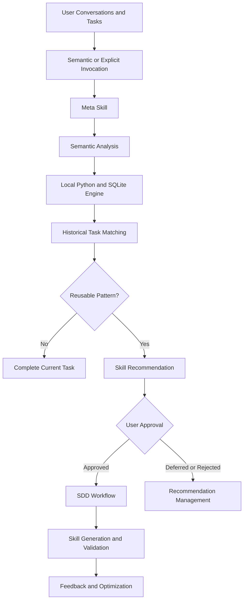

# Skill Lifecycle Management (SLM)

**Discover repeatable work. Turn proven experience into reusable skills.**

[简体中文](README_CN.md) · [Releases](https://github.com/yinziwen/skill-lifecycle-management/releases) · [Host Acceptance Tests](docs/HOST-TEST.md) · [Changelog](CHANGELOG.md)


](https://skills.sh/yinziwen/skill-lifecycle-management)

## Overview

Skill Lifecycle Management (SLM) is an intelligent skill creation and lifecycle management tool based on semantic analysis and Spec-Driven Development (SDD).

It combines a Meta Skill with an independent Python/SQLite engine to identify repetitive tasks, discover reusable workflows, and recommend creating, reusing, or optimizing skills.

Instead of requiring users to manually identify reusable capabilities, SLM helps discover valuable patterns during everyday AI-assisted work. Users remain in control of all skill creation and modification decisions.

## Features

| Feature | Description |
| --- | --- |
| Semantic Discovery | Identifies similar task intentions expressed in different ways |
| Dual Invocation | Supports host-driven semantic invocation and explicit invocation |
| Cross-session Memory | Stores authorized task summaries in a persistent local database |
| Pattern Detection | Identifies independently repeated tasks and reusable workflows |
| Proactive Recommendations | Recommends creating, reusing, or optimizing skills |
| Human Approval | Requires explicit approval before skill creation or modification |
| SDD Workflow | Generates specifications, plans, tasks, instruction-based skills, and test cases |
| Continuous Optimization | Evaluates actual feedback and proposes improvements |
| Version Management | Supports version history and rollback |
| Recommendation Control | Supports deferral, rejection, cooldown, and permanent dismissal |
| Dependency Validation | Validates declared runtime requirements and dependencies |

## Architecture



## Requirements

- Python 3.9 or later with SQLite support.
- Authorized local filesystem and script execution access.
- An AI host supporting Agent Skills and semantic reasoning.
- Node.js and npm when using the external Skills CLI.

The core engine uses the Python standard library and requires no additional Python runtime packages.

## Installation

### Method 1: Skills CLI

For a public or otherwise accessible repository:

```bash
npx skills add yinziwen/skill-lifecycle-management
```

Install the specified skill:

```bash
npx skills add yinziwen/skill-lifecycle-management --skill skill-lifecycle-management
```

Install globally for TRAE CN:

```bash
npx skills add yinziwen/skill-lifecycle-management -a trae-cn -g
```

Install globally for Codex:

```bash
npx skills add yinziwen/skill-lifecycle-management -a codex -g
```

Install globally for Claude Code:

```bash
npx skills add yinziwen/skill-lifecycle-management -a claude-code -g
```

Check installed skills:

```bash
npx skills list -g
```

### Method 2: Download ZIP

Download an installation package from:

[GitHub Releases](https://github.com/yinziwen/skill-lifecycle-management/releases)

- Standard ZIP: intended for hosts supporting the Agent Skills format.
- TeleAgent ZIP: uses the lowercase `skill.md` entry required by its distribution format.

Import the package using the host's supported skill installation mechanism.

### Method 3: Local Installation

Clone the repository:

```bash
git clone https://github.com/yinziwen/skill-lifecycle-management.git
cd skill-lifecycle-management
```

Install from the local skill directory:

```bash
npx skills add ./skills/skill-lifecycle-management
```

Successful installation does not guarantee automatic invocation or runtime compatibility.

## Quick Start

### 1. Initialize the Skill

Enable SLM and authorize a fixed local directory for storing redacted task summaries.

Use the same authorized directory across sessions.

Suggested initialization prompt:

> Initialize Skill Lifecycle Management. Record and analyze reusable task experience within the authorized local directory. Recommend skill creation or optimization when sufficient evidence is available. Ask for my approval before creating, modifying, installing, or publishing any skill.

### 2. Work Normally

You do not need to explicitly mention SLM in every conversation.

For example:

- Fix this bug without affecting unrelated modules.
- Preserve existing business behavior while modifying this feature.
- Analyze the impact of the change and check for unnecessary modifications.

When the host invokes SLM, it can compare these tasks with previously recorded experience.

### 3. Discover Reusable Patterns

By default, recommendations require at least three independent verified successful tasks.

Two verified tasks may be sufficient when there is evidence of high reuse value.

Repeated conversations about the same task are not counted as separate tasks.

### 4. Review Recommendations

When a reusable pattern is discovered, SLM may offer the following choices:

- Create a skill.
- Adjust the proposed scope.
- Defer the recommendation.
- Ignore similar recommendations.

Review the specific proposal and its hash before approving changes.

### 5. Continuous Optimization

SLM records actual execution feedback and proposes improvements when justified.

Optimization requires user approval and follows the SDD workflow.

Generated skills must undergo dependency checks and actual behavior validation before installation or publication.

## Explicit Invocation

When automatic invocation is unavailable, use natural-language requests such as:

- Analyze my recent work and identify reusable task patterns.
- Turn this verified workflow into a reusable skill.
- Check whether an equivalent skill already exists.
- Evaluate and optimize an existing skill.

You can also invoke `skill-lifecycle-management` explicitly through the host.

## SDD Workflow

SLM follows Spec-Driven Development:

1. Specify requirements and acceptance criteria.
2. Clarify scope, constraints, and dependencies.
3. Design the implementation.
4. Break down development tasks.
5. Generate an instruction-based skill.
6. Validate the result.
7. Record versions and execution feedback.
8. Propose improvements when necessary.

## Project Structure

```text
skill-lifecycle-management/
├── .github/
│   └── workflows/
├── skills/
│   └── skill-lifecycle-management/
│       ├── SKILL.md
│       ├── README.md
│       ├── scripts/
│       ├── adapters/
│       ├── assets/
│       ├── references/
│       ├── specs/
│       └── tests/
├── tools/
│   └── package.py
├── docs/
├── .gitignore
├── README.md
├── README_CN.md
├── CHANGELOG.md
├── SECURITY.md
└── LICENSE
```

The complete installable skill is located in:

`skills/skill-lifecycle-management/`

The detailed execution protocol is maintained in its `references/` directory.

## Development and Testing

Run the following commands from the repository root.

Check the version:

```bash
python skills/skill-lifecycle-management/scripts/slm.py --version
```

View CLI commands:

```bash
python skills/skill-lifecycle-management/scripts/slm.py --home ./local-test-data --help
```

Run regression tests:

```bash
python -m unittest discover -s skills/skill-lifecycle-management/tests -v
```

Test with isolated synthetic data:

```bash
python skills/skill-lifecycle-management/scripts/slm.py --home ./local-test-data observe skills/skill-lifecycle-management/assets/task.example.json
```

Query the test records:

```bash
python skills/skill-lifecycle-management/scripts/slm.py --home ./local-test-data tasks --project demo
```

The sample is unverified synthetic data and must not be counted as a verified successful task.

See the [CLI Reference](docs/CLI-CN.md) for more commands.

## Build Installation Packages

```bash
python tools/package.py
```

The packaging script generates standard and TeleAgent ZIP distributions together with SHA-256 checksums.

GitHub Actions is configured for cross-platform regression testing and artifact generation. Public releases require separate review and publication.

## Test Results

| Test Scope | Result |
| --- | --- |
| Core regression tests | 47/47 passed |
| Standard ZIP regression tests | 47/47 passed |
| TeleAgent ZIP regression tests | 47/47 passed |
| Database migration | Passed |
| Cross-process persistence | Passed |
| Concurrent task deduplication | Passed |
| Approval integrity | Passed |
| Dependency declaration validation | Passed |
| Version rollback | Passed |

The distribution tests were executed on Linux with Python 3.13.5 using synthetic test records.

See:

- [Core Test Results](docs/TEST-RESULTS.txt)
- [Distribution Test Results](docs/DISTRIBUTION-TEST.txt)
- [Host Acceptance Tests](docs/HOST-TEST.md)

## Platform Compatibility

| Platform | Status |
| --- | --- |
| TeleAgent | Dedicated installation package available; host acceptance pending |
| TRAE | Standard-format candidate; full host validation pending |
| Codex | Standard-format candidate; full host validation pending |
| Claude Code | Standard-format candidate; full host validation pending |
| Other Agent Skills hosts | Compatibility depends on host capabilities |

## Security and Privacy

- Local-first data storage.
- Only authorized and redacted task summaries are recorded.
- Project isolation is enabled by default.
- Cross-project sharing requires authorization.
- No automatic upload of conversation history.
- No unauthorized creation, modification, installation, or publication of skills.
- No automatic dependency installation.
- No access to private internal host conversation databases.

Back up the existing skill and complete data directory before upgrading.

Stop database writers before backup and preserve SQLite WAL state where applicable. Do not run different versions concurrently against the same database.

See [Security Policy](SECURITY.md).

## Known Limitations

- Automatic invocation depends on the host model and skill-routing mechanism.
- SLM is not a background conversation listener.
- Tasks cannot be observed when the host does not invoke the skill.
- Semantic extraction relies on the host LLM; no independent embedding model is included.
- Cross-session task continuation requires a stable task ID.
- Generated skills are instruction-based drafts, not generated executable scripts.
- Dependency discovery does not guarantee runtime compatibility.
- Local approval checks are not independent human identity authentication.
- Real semantic accuracy, invocation rates, and efficiency gains require host-level evaluation.
- GitHub-hosted CI execution has not yet been verified.

## Roadmap

- [x] Independent core engine
- [x] SQLite persistence
- [x] Repeated task detection
- [x] Human approval
- [x] SDD-based skill creation
- [x] Skill evaluation and optimization
- [x] Version management and rollback
- [x] Cross-session task identity improvements
- [x] Dependency declaration validation
- [ ] Full cross-platform host acceptance
- [ ] Semantic invocation accuracy evaluation
- [ ] Independent embedding provider
- [ ] Optional event-driven host adapters
- [ ] Real workflow efficiency benchmarks

## Contributing

Issues and pull requests are welcome.

Please include reproducible steps, expected behavior, actual behavior, and relevant test evidence when reporting problems.

Follow the existing SDD workflow and avoid unrelated changes.

## License

This project is licensed under the [MIT License](LICENSE).

## Author

[yinziwen](https://github.com/yinziwen)

---

Discover reusable capabilities. Improve skills through proven experience.
