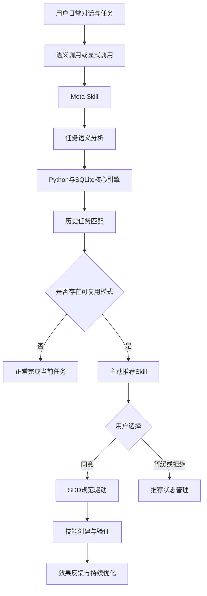

# Skill 创建助手（SLM）

**主动发现重复工作，将经过验证的经验沉淀为可复用 Skill。**

[English](README.md) · [版本下载](https://github.com/yinziwen/skill-lifecycle-management/releases) · [宿主验收](docs/HOST-TEST.md) · [更新日志](CHANGELOG.md)


## 项目简介

Skill 创建助手（Skill Lifecycle Management，简称 SLM）是一款基于语义分析与 SDD（规范驱动开发）的智能 Skill 创建和生命周期管理工具。

采用 Meta Skill + Python/SQLite 独立核心引擎架构，从用户日常对话与任务执行过程中识别重复性问题、相似任务流程和可复用经验，主动推荐创建、复用或优化 Skill。

与普通 Skill 创建工具不同，SLM 不仅关注如何创建 Skill，还关注如何主动发现值得沉淀的能力，并通过真实反馈持续优化。

所有技能创建及修改操作均由用户最终决定。

## 核心功能

| 功能 | 功能说明 |
| --- | --- |
| 智能语义识别 | 理解不同语言表达背后的相似任务意图 |
| 双模式调用 | 支持宿主语义自动调用与用户显式调用 |
| 跨会话记忆 | 在授权范围内积累和检索历史任务经验 |
| 重复任务检测 | 识别独立重复任务及可复用工作模式 |
| 主动推荐 | 推荐创建、复用或优化已有 Skill |
| 智能查重 | 检查已有能力，避免重复创建 |
| 人工审批 | 创建及优化前必须征求用户同意 |
| SDD 创建 | 规范驱动的技能规格、设计、任务及实现 |
| 效果评估 | 基于真实执行结果和用户反馈进行评估 |
| 持续优化 | 根据实际反馈提出技能优化建议 |
| 版本管理 | 支持历史版本记录及回滚 |
| 推荐控制 | 支持暂缓、拒绝、冷却及不再提醒 |
| 依赖校验 | 检查技能声明的运行环境及依赖 |

## 系统架构



## 适用场景

- 软件开发与代码维护
- 故障排查与问题诊断
- API 接口开发及联调
- 数据分析与批量处理
- 文档生成与知识沉淀
- 重复性办公任务
- 工作流程标准化
- 已有 Skill 的评估与优化

## 环境要求

- Python 3.9 或以上版本，包含 SQLite 支持。
- 已授权的本地文件读写及脚本执行权限。
- 支持 Agent Skills 加载及语义理解的 AI 宿主。
- 使用外部 Skills CLI 安装时，需要 Node.js 和 npm。

核心引擎采用 Python 标准库，无额外 Python 运行时依赖。

## 安装方式

### 方式一：命令行安装（推荐）

仓库公开或当前用户具备访问权限后，执行：

```bash
npx skills add yinziwen/skill-lifecycle-management
```

指定技能安装：

```bash
npx skills add yinziwen/skill-lifecycle-management --skill skill-lifecycle-management
```

#### TRAE 国内版全局安装

```bash
npx skills add yinziwen/skill-lifecycle-management -a trae-cn -g
```

#### Codex 全局安装

```bash
npx skills add yinziwen/skill-lifecycle-management -a codex -g
```

#### Claude Code 全局安装

```bash
npx skills add yinziwen/skill-lifecycle-management -a claude-code -g
```

查看已安装技能：

```bash
npx skills list -g
```

### 方式二：ZIP 安装

进入版本发布页面：

[下载 Skill 创建助手](https://github.com/yinziwen/skill-lifecycle-management/releases)

根据使用的平台选择安装包：

| 安装包 | 适用平台 |
| --- | --- |
| 通用 Skill 安装包 | 支持标准 Agent Skills 格式的 AI 工具 |
| TeleAgent 专用安装包 | 星辰超级智能体本地上传 |

下载后通过对应平台支持的技能导入功能进行安装。

TeleAgent 使用小写 `skill.md` 入口，通用版本使用标准 `SKILL.md` 入口。

### 方式三：本地源码安装

```bash
git clone https://github.com/yinziwen/skill-lifecycle-management.git

cd skill-lifecycle-management

npx skills add ./skills/skill-lifecycle-management
```

安装成功仅代表技能文件部署成功，实际调用能力及运行兼容性需要进一步验证。

## 快速开始

### 第一步：初始化技能

首次使用时，需要授权一个固定的本地数据存储目录，用于保存脱敏后的任务摘要及技能管理信息。

可以向 AI 发送：

> 初始化 Skill 创建助手，在授权目录中记录和分析具有复用价值的任务经验。发现重复性任务后主动推荐创建或优化 Skill。未经我的明确授权，不得创建、修改、安装或发布技能。

后续不同会话使用同一个已授权的数据目录。

### 第二步：正常使用 AI

不需要每次输入技能名称。

例如，在不同任务中提出：

- 修复这个问题，不要影响其他业务模块。
- 修改当前功能时，保持原有业务逻辑不变。
- 先分析代码影响范围，完成后检查无关修改。

当宿主模型主动调用 Skill 创建助手时，系统可以提取任务语义，并与历史经验进行匹配。

### 第三步：主动发现重复任务

系统综合分析：

- 任务目标
- 执行流程
- 约束条件
- 验证结果
- 历史任务记录
- 已有 Skill
- 实际复用价值

默认发现三个独立、经过验证的成功任务后，可以提出技能创建建议。

具有充分复用价值证据的任务，至少两次独立成功后可以提前推荐。

同一任务的多轮沟通不会被重复计数。

### 第四步：用户选择

发现可复用能力后，系统可以提供以下选择：

1. 创建 Skill。
2. 调整技能方案。
3. 暂不创建，继续积累经验。
4. 不再推荐此类技能。

用户确认具体提案及其哈希后，系统才会按照 SDD 流程创建或优化 Skill。

### 第五步：持续优化

系统根据真实的技能执行结果和用户反馈，识别优化机会。

经用户审批后，可以更新技能规格、调整实现并执行回归验证。

生成的技能必须通过依赖检查和真实行为验证，才能认定为适合安装或发布的版本。

## 使用示例

假设开发者在三个独立任务中反复使用相似的代码修改流程。

| 任务 | 用户输入 |
| --- | --- |
| 任务一 | 修改代码时不要影响其他模块 |
| 任务二 | 修复当前问题，保持原有业务逻辑 |
| 任务三 | 分析变更影响范围，检查是否存在无关修改 |

系统可以将这些任务归纳为共同的工程目标：

**控制代码修改范围，避免非预期变更。**

当满足推荐条件后，系统可能建议：

> 检测到多个独立任务具有相似的代码变更控制流程，建议将其封装为「最小范围代码修改」Skill。是否创建？

用户可以根据实际情况选择创建、调整、暂缓或不再提醒。

以上为预期交互示例，不代表所有宿主都能自动触发。

## 显式调用

当宿主没有主动调用技能时，可以直接使用以下自然语言：

- 帮我分析最近有哪些重复性任务。
- 将这次经过验证的工作流程封装为 Skill。
- 检查是否已经存在类似的 Skill。
- 帮我评估已有 Skill 的实际执行效果。
- 根据使用反馈提出技能优化建议。

也可以通过宿主明确调用 `skill-lifecycle-management`。

## SDD 规范驱动开发

Skill 创建和优化遵循以下流程：

| 阶段 | 主要职责 |
| --- | --- |
| Specify | 定义技能目标、需求规格和验收标准 |
| Clarify | 澄清需求、适用范围、约束及依赖 |
| Plan | 制定技术方案及执行流程 |
| Tasks | 拆解实现及测试任务 |
| Implement | 生成指令型 Skill |
| Verify | 执行测试并验证实际行为 |
| Evaluate | 记录实际执行结果及反馈 |
| Optimize | 经审批后持续优化及管理版本 |

## 项目结构

```text
skill-lifecycle-management/
├── .github/
│   └── workflows/          # 自动化测试与打包
├── skills/
│   └── skill-lifecycle-management/
│       ├── SKILL.md        # 技能入口
│       ├── README.md       # 技能使用说明
│       ├── scripts/        # 核心执行脚本
│       ├── adapters/       # 平台适配
│       ├── assets/         # 示例及资源
│       ├── references/     # 执行协议
│       ├── specs/          # SDD 规格
│       └── tests/          # 自动化测试
├── tools/
│   └── package.py          # 自动打包脚本
├── docs/                  # 项目文档
├── .gitignore
├── README.md
├── README_CN.md
├── CHANGELOG.md
├── SECURITY.md
└── LICENSE
```

完整的可安装技能位于：

`skills/skill-lifecycle-management/`

详细执行协议位于技能目录下的 `references/` 中。

## 开发与测试

以下命令均在仓库根目录执行。

查看版本：

```bash
python skills/skill-lifecycle-management/scripts/slm.py --version
```

查看核心命令：

```bash
python skills/skill-lifecycle-management/scripts/slm.py --home ./local-test-data --help
```

执行全部回归测试：

```bash
python -m unittest discover -s skills/skill-lifecycle-management/tests -v
```

使用独立测试目录录入合成任务：

```bash
python skills/skill-lifecycle-management/scripts/slm.py --home ./local-test-data observe skills/skill-lifecycle-management/assets/task.example.json
```

查询测试任务记录：

```bash
python skills/skill-lifecycle-management/scripts/slm.py --home ./local-test-data tasks --project demo
```

示例数据属于未经验证的合成任务，不计入真实成功经验。

测试完成后，可以删除独立的 `local-test-data` 目录。

更多命令请参考 [CLI 使用指南](docs/CLI-CN.md)。

## 自动打包

执行：

```bash
python tools/package.py
```

打包脚本负责生成：

- 通用 Skill ZIP 安装包
- TeleAgent 专用 ZIP 安装包
- SHA-256 文件校验清单

GitHub Actions 已配置跨平台自动化测试及打包流程。

公开发布 Release 需要独立审核及发布操作。

## 测试结果

| 测试项目 | 测试结果 |
| --- | --- |
| 核心自动化回归测试 | 47/47 通过 |
| 通用安装包回归测试 | 47/47 通过 |
| TeleAgent 安装包回归测试 | 47/47 通过 |
| 历史数据库迁移 | 通过 |
| 跨进程数据共享 | 通过 |
| 并发任务去重 | 通过 |
| 审批完整性校验 | 通过 |
| 依赖声明校验 | 通过 |
| 技能版本回滚 | 通过 |

上述测试在 Linux、Python 3.13.5 环境下执行，使用合成测试数据。

核心测试通过不代表所有宿主平台、语义识别及自动触发能力均已通过真实环境验证。

详细测试报告：

- [核心测试报告](docs/TEST-RESULTS.txt)
- [发布包复测报告](docs/DISTRIBUTION-TEST.txt)
- [宿主验收测试](docs/HOST-TEST.md)

## 平台兼容性

| 平台 | 当前状态 |
| --- | --- |
| TeleAgent 星辰超级智能体 | 提供专用安装包，待完整宿主验收 |
| TRAE | 提供通用 Skill 格式，待完整宿主验收 |
| Codex | 提供通用 Skill 格式，待完整宿主验收 |
| Claude Code | 提供通用 Skill 格式，待完整宿主验收 |
| 其他 Agent Skills 平台 | 取决于宿主实际支持能力 |

## 安全与隐私

- 默认使用本地存储。
- 仅记录经过授权的脱敏任务摘要。
- 默认隔离不同项目的数据。
- 跨项目经验共享需要授权。
- 不擅自上传原始对话或业务数据。
- 不读取宿主内部私有会话数据库。
- 不自动安装额外运行依赖。
- 创建、修改、安装和公开发布 Skill 前分别获得用户授权。

升级前请备份原有 Skill 及完整数据目录。

备份 SQLite 数据库前应停止写入，并妥善处理 WAL 文件。避免不同版本同时访问同一个数据库。

详细说明见 [安全政策](SECURITY.md)。

## 当前版本限制

- 语义自动调用依赖宿主模型及技能路由机制。
- 不提供独立后台对话监听。
- 宿主未调用 Skill 时，无法自动发现当前任务。
- 语义分析依赖宿主 LLM，尚未集成独立 Embedding 模型。
- 同一任务跨会话继续执行时，需要复用稳定的任务 ID。
- 当前生成的是指令型 Skill 草稿，不自动生成可执行脚本。
- 依赖检查通过不代表实际运行一定成功。
- 本地审批机制不等同于独立的人类身份认证。
- 真实语义准确率、自动触发率及提效幅度仍需实际测试。
- GitHub Actions 云端执行尚未验证。

## 开发路线图

- [x] Meta Skill 与独立核心引擎
- [x] SQLite 本地持久化
- [x] 重复任务检测
- [x] 用户审批机制
- [x] SDD 规范驱动创建
- [x] 技能评估及持续优化
- [x] 版本管理与回滚
- [x] 跨会话任务身份管理
- [x] 运行依赖声明校验
- [ ] 完整跨平台兼容性验收
- [ ] 真实语义自动触发评估
- [ ] 独立 Embedding Provider
- [ ] 可选事件驱动平台适配器
- [ ] 真实工作场景提效评估

## 参与贡献

欢迎通过 Issues 提交问题、功能建议和使用反馈，也欢迎提交 Pull Request。

提交问题时，建议包含复现步骤、预期结果、实际结果及相关测试证据。

代码修改应遵循现有 SDD 流程，避免无关变更。

## 开源协议

本项目采用 [MIT License](LICENSE) 开源协议。

## 项目作者

[yinziwen](https://github.com/yinziwen)

---

让重复任务沉淀为技能，让技能在使用中持续进化。
